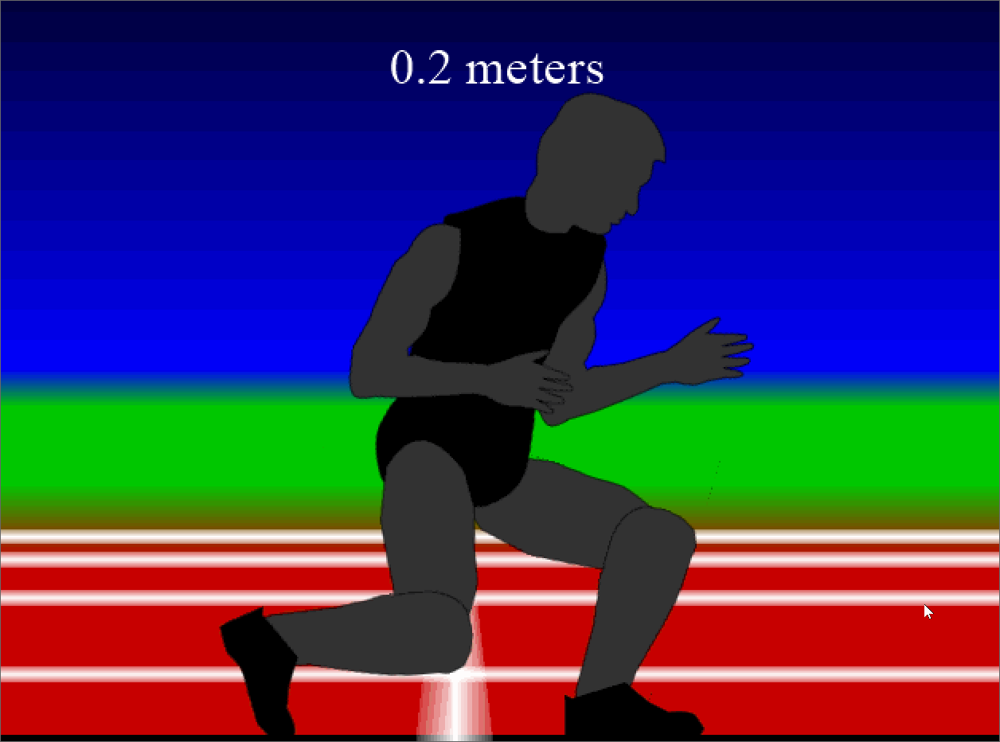
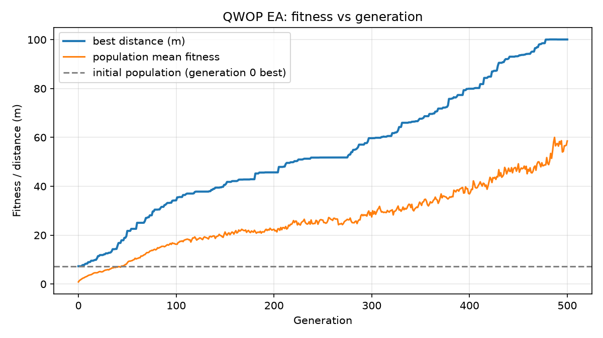

# QWOP — Evolutionary Algorithm

An evolutionary algorithm (EA) that learns to play QWOP by evolving sequences of keyboard inputs. The objective is to develop a controller capable of completing the 100-metre race within 60 seconds while minimizing completion time.

## Overview

This project extends a Python 3 clone of [QWOP](http://www.foddy.net/Athletics.html) written using [Pymunk](http://www.pymunk.org/en/latest/index.html#) and [Pyglet](https://pyglet.readthedocs.io/en/latest/index.html). Sprites were made with [Inkscape](https://inkscape.org/).



Rather than manually controlling the runner, the EA evolves timed combinations of the Q, W, O and P keys through repeated simulation, evaluation, selection and variation. Training runs without a graphical window and supports parallel evaluation across multiple CPU cores. Saved controllers can be replayed visually and recorded as MP4 videos.

## Build and run

### 1. Clone the repository

```bash
git clone <repository-url>
cd QWOP
```

Replace `<repository-url>` with the URL of this repository.

### 2. Install dependencies

Python 3 is required. Run the following from the project directory:

```bash
python3 -m pip install pymunk pyglet numpy matplotlib imageio imageio-ffmpeg
```

| Library | Purpose |
| --- | --- |
| Pymunk | Physics simulation and collision detection |
| Pyglet | Graphical rendering and keyboard events |
| NumPy | Genome representation and evolutionary operations |
| Matplotlib | Training performance plots |
| ImageIO and ImageIO-FFmpeg | Optional MP4 replay recording |

### 3. Run the program

```bash
python3 qwop_ea.py test
python3 qwop_ea.py train
python3 qwop_ea.py play
python3 qwop_ea.py baseline
```

| Mode | Description |
| --- | --- |
| `test` | Evaluate one randomly generated genome and display its simulation results. |
| `train` | Evolve a population of QWOP controllers and save the best solution. |
| `play` | Open the graphical viewer to replay saved controllers. Press **S** to begin. |
| `baseline` | Evaluate randomly generated controllers for comparison with evolutionary search. |

The included `ea_output/` directory contains a trained controller, so playback can be run without retraining.

## Evolutionary algorithm

### Genome representation

Each individual is represented by a binary matrix of shape `(600, 4)`. Each row specifies which keys are held during a 0.1-second interval, allowing a controller to encode up to 60 seconds of gameplay.

| Key | Action |
| --- | --- |
| Q | Move left thigh |
| W | Move right thigh |
| O | Move left calf |
| P | Move right calf |

For example, `[1, 0, 1, 0]` activates Q and O simultaneously. The simulator applies the encoded inputs at fixed physics ticks.

### Evolutionary process

1. **Initialization:** Generate random binary genomes or seed part of the population using a previously saved best genome.
2. **Evaluation:** Simulate each individual and calculate fitness based on distance, survival time and race completion.
3. **Selection:** Use tournament selection to identify parents.
4. **Crossover:** Combine two parents using one-point crossover.
5. **Mutation:** Randomize selected input rows and flip individual bits. Most mutations are concentrated near the end of the active genome region.
6. **Replacement:** Preserve elite individuals, introduce offspring and add random immigrants to maintain population diversity.
7. **Repeat:** Continue until the specified generation limit is reached.

### Fitness function

For an unfinished runner, fitness primarily rewards forward distance, with a small adjustment for survival time. For a successful runner, fitness rewards faster completion:

```text
Unfinished: min(100 × p × (0.9 + 0.1 × s), 100 − 0.000001)
Finished:   100 + (60 − finish_time)

p = min(max(distance, 0) / 100, 1)
s = min(elapsed_time / 60, 1)
```

Distance is measured in metres and time in seconds. A successful controller always receives a higher fitness than an unfinished controller.

### Simulation constraints

Training and graphical playback use the same simulation logic. To discourage unrealistic movement and reduce wasted computation, the simulator applies the following default constraints:

- Progress is measured using the average horizontal position of both feet, relative to the starting position.
- Distance is credited while grounded (with an initial settling exception); completing the race requires ground contact.
- Excessive airtime ends the simulation after a 0.25-second grace period following initial ground contact.
- Measured forward speed exceeding 12 m/s ends the run.
- A run ends when the runner falls, stalls, finishes or reaches the 60-second time limit.
- Stall detection terminates runs that fail to make sufficient progress (0.1 m) over approximately 3 seconds.

## Default configuration

| Parameter | Default |
| --- | ---: |
| Population size | 500 |
| Generations | 500 |
| Elite individuals | 10 |
| Tournament size | 3 |
| Crossover probability | 0.30 |
| Input-row mutation probability | 0.03 |
| Bit-flip probability | 0.01 |
| Random immigrant fraction | 0.25 |
| Active genome margin | 10 input steps |
| Input duration | 0.1 s |
| Maximum simulation time | 60 s |
| Random seed | 16 |
| Parallel workers | CPU count − 1 (minimum 1) |

These settings can be modified in `qwop_ea.py`. Population size, generation count, worker count and seed can also be supplied through the command line for training:

```bash
python3 qwop_ea.py train --pop 500 --generations 500 --workers 4 --seed 16
```

To disable video recording during playback:

```bash
python3 qwop_ea.py play --no-record
```

### Starting a new experiment

Training automatically loads `ea_output/best_genome.npy` when a compatible saved genome exists. This allows further evolution of an existing solution, but is not an exact checkpoint resume of the entire population.

For an independent experiment starting from a random population, back up or rename the existing `ea_output/` directory before training. Training overwrites the current logs, plot and generation history, so preserve previous results before rerunning experiments.

The default random-search baseline evaluates 250,500 genomes, matching the default training loop's 500 individuals across generation 0 and 500 subsequent generations. Changing the training budget requires adjusting the baseline sample budget in the code for a fair comparison.

## Results

The included training log demonstrates that the EA successfully achieved the project objective of completing 100 metres within 60 seconds.

| Metric | Recorded result |
| --- | ---: |
| Initial best distance | 7.29 m |
| First successful generation | 478 |
| Best-fitness controller distance | 100.08 m |
| Best completion time | 18.21 s |
| Best fitness | 141.79 |
| Successful individuals in generation 500 | 62 / 500 |
| Total population evaluations | 250,500 |

The best fitness was first recorded at generation 491 and retained through generation 500. These values describe the experiment saved in `ea_output/fitness_log.csv`; results from other runs may vary.

### Training performance



[Watch the recorded best-controller replay](ea_output/videos/qwop_BEST_EVER_20261117_221044.mp4)

## Replay controls

| Key | Action |
| --- | --- |
| S | Start or restart the selected controller |
| Left / Right arrows | Select a saved generation for the next replay |
| Space | Pause or resume playback |
| D | Toggle physics debug rendering |
| Esc | Close the viewer |

The viewer initially selects the best saved controller. It displays scored distance and highlights active QWOP inputs during playback.

## Project structure

```text
QWOP/
├── qwop_ea.py                          # Evolutionary algorithm and replay viewer
├── qwop.py                             # Original interactive QWOP game
├── game_class.py                       # Game environment and rendering
├── character.py                        # Runner physics and movement
├── generate_samples.py                 # Script for generating sample runs
├── play_scripted_sequence.py           # Scripted gameplay
├── assets/                             # Game sprites and original demo GIF
├── examples/                           # Physics and graphics examples
└── ea_output/                          # Generated experiment outputs
    ├── best_genome.npy                 # Best saved controller
    ├── best_per_generation.npz         # Best controller from each generation
    ├── fitness_log.csv                 # Per-generation performance metrics
    ├── fitness_vs_generation.png
    └── videos/                         # Recorded gameplay (MP4)
```

## Acknowledgements

This project builds on the original Python QWOP clone and the game [QWOP](http://www.foddy.net/Athletics.html). The evolutionary controller, fitness evaluation, parallel training, performance tracking and automated replay extend the existing game environment for the CISC455 course project.
